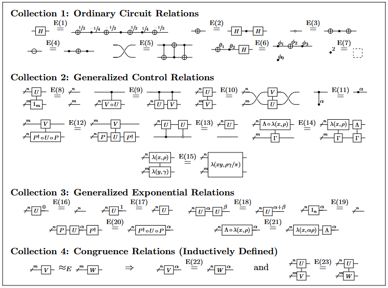

---

##### Download

+ [Paper](https://arxiv.org/pdf/2611.07207v1)

---

##### Abstract

 Controlled subcircuits are commonplace in quantum algorithms as they represent the quantum analogue of branching statements (`if then`).
 We introduce a generalization of controlled subcircuits in the form of a binary operation which sends pairs of unitary quantum circuits to a generalized controlled operation, whose semantics are based on matrix exponentials and logarithms.
 The family of quantum circuits with generalized controlled operations and circuit exponentiation is denoted HQC for Hierarchical Quantum Circuits.
 We formalize HQC as a modified prop category using a novel category-theoretic construction, and provide a sound and complete equational theory for diagrammatic reasoning in HQC.
  
---

##### Figure 5: An equational theory for the category of hierarchical quantum circuits. 



---

##### Citation

```latex
@article{SW2026,
title     = {A Complete Equational Theory for Quantum Circuits with Generalized Control},
volume    = {456},
doi       = {10.4204/EPTCS.456.11},
journal   = {Electronic Proceedings in Theoretical Computer Science},
publisher = {Open Publishing Association},
author    = {William Schober and Scott Wesley},
year      = {2026},
month     = Nov,
pages     = {283--349}
}
```
